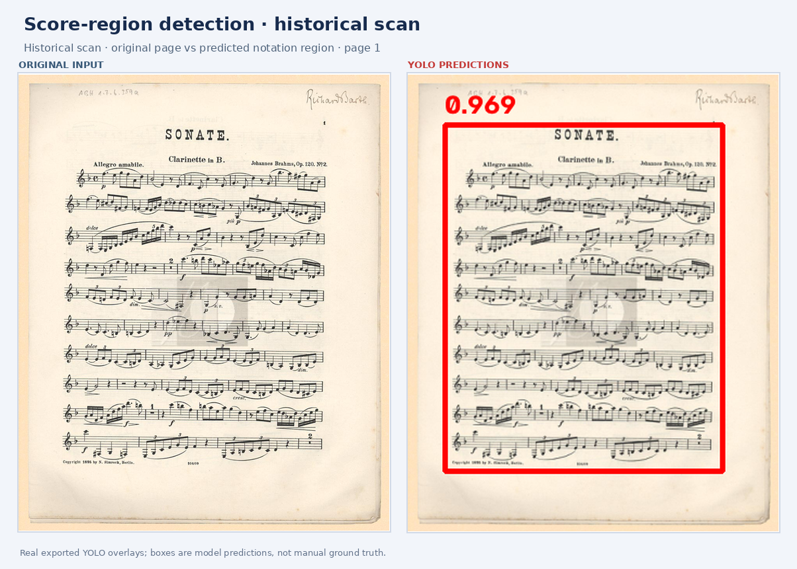
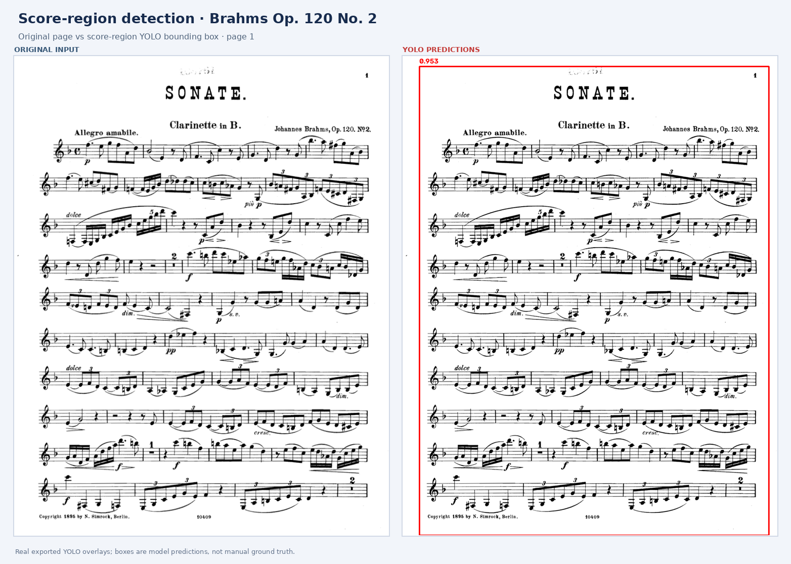
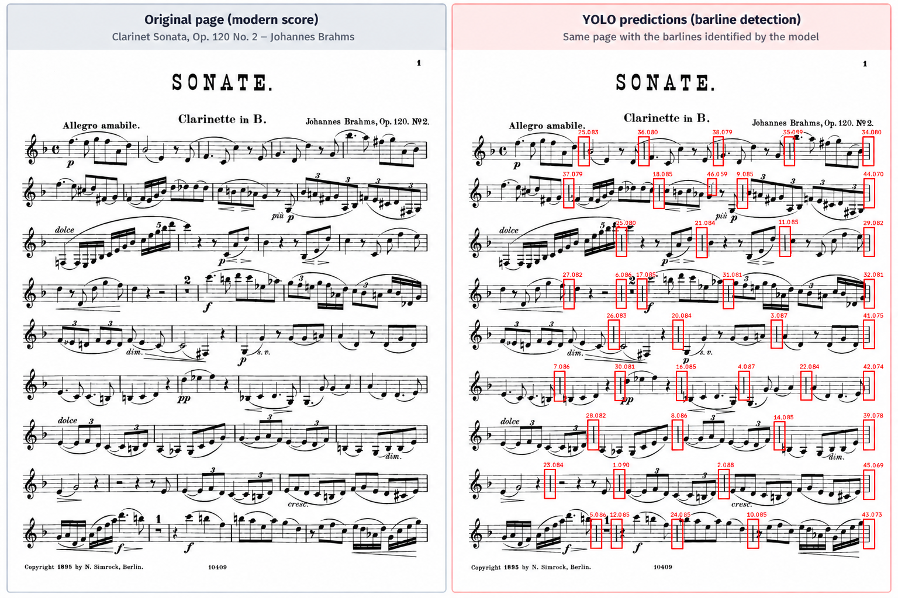
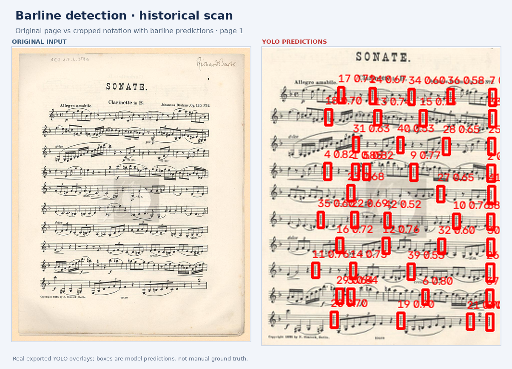
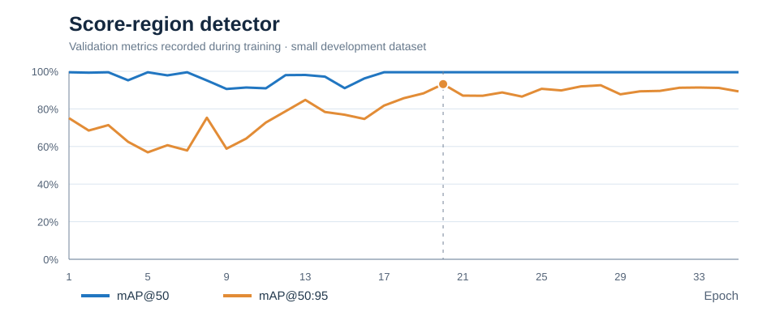
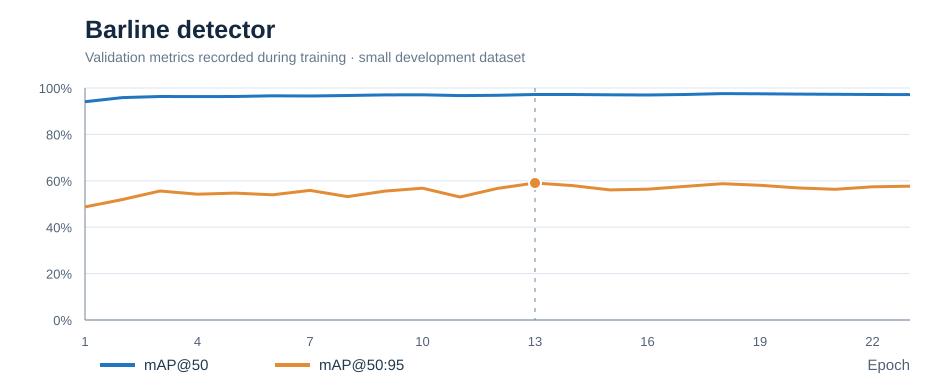

# SpEl — Experimental Music Score Analysis

**Computer vision for digital sheet music · Research prototype · Work in progress**

SpEl is a broader project devoted to the development of coordinated electronic sheet music. I am working on experimental computer-vision components intended to support its development.

**Project context:** [SpEl — Spartito Elettronico Coordinato, Orchestra Filarmonici Friulani](https://filarmonicifriulani.com/progetto/spel-spartito-elettronico-coordinato/).

The detectors documented here are **beta research prototypes**, not a finished SpEl product or a production-ready music-recognition system.

## Research objective

Build an automated pipeline to locate musical notation within scanned PDF pages and identify **barlines (measure separators)**. This is an early technical step toward score navigation and measure-level indexing.

The prototype uses two successive object detectors:

1. **Score-region detection** — locate the notation area on the original page and crop it.
2. **Barline detection** — identify candidate measure separators in the crop, then map their coordinates back to the original page.

The current local prototype supports PDF/JPG/PNG input, annotated previews, adjustable confidence thresholds, and coordinate export. It has been tested locally; **no public interactive demo is currently hosted**.

## Technology and status

- **Python**, **PyTorch**, **Ultralytics YOLO26n**, **OpenCV**, **Streamlit**.
- Two separately fine-tuned detectors, one for the score region and one for barlines.
- The local prototype has completed end-to-end functional testing.
- The barline detector is still being refined. False positives, missed separators, and variations in scan quality remain research challenges.
- **Preliminary validation metrics are available** from the two saved training checkpoints. These reflect small development datasets and should not be interpreted as independent evidence of real-world generalization.

## YOLO in action — real prediction examples

The following images show **actual outputs exported from the local detectors** on pages from Brahms's *Clarinet Sonata, Op. 120 No. 2*. Each panel compares the source page with the model's annotated output. Red bounding boxes indicate model predictions, **not manually verified ground truth**; the accompanying numbers are confidence scores.

### 1. Automatic score-region localization

The first model identifies the area occupied by musical notation and can remove substantial outer margins, including on historical scans.

### 2. Barlines in a modern edition

The second model detects candidate measure separators across a densely notated page. It works encouragingly well for a small-data beta, but some candidates may be misaligned or correspond to other vertical symbols.

### 3. Barlines in a historical scan

The historical edition offers a more challenging test of print quality and layout variation. These examples illustrate the workflow, **not a quantitative accuracy benchmark**.

More context, validation curves and limitations are documented in [RESULTS.md](RESULTS.md).

## Preliminary results

Both detectors were fine-tuned on **small, purpose-built datasets**. They are promising beta experiments, not production-ready systems. In particular, strong validation scores on a limited sample do not establish reliability across unseen editions, scan qualities or orchestral layouts.

| Checkpoint | Validation precision | Validation recall | mAP@50 | mAP@50:95 |
|---|---:|---:|---:|---:|
| Score-region detector | 99.7% | 100.0% | 99.5% | 93.2% |
| Barline detector | 97.4% | 96.3% | 97.2% | 59.1% |

*Figures were extracted from the `train_metrics` stored in the two supplied Ultralytics checkpoints. These are internal validation figures, not independent test-set scores. The different mAP@50:95 values highlight the difficulty of precise barline localization.*

### Training history

The plots show **validation mAP recorded at each epoch**, including epochs other than the selected best checkpoint. The score-region model's selected best epoch is 20 of 35; the barline model's selected best epoch is 13 of 23.

## Sample material

Example input scores used during development include:
- Beethoven — Symphony No. 5, violin part
- Brahms — Clarinet Sonata Op. 120 No. 2, including a historical scan
- Grieg — Piano Concerto Op. 16, viola part
- Mozart — Symphony No. 40, violin and oboe parts
- Mozart — Piano Concerto No. 21, bassoon part

The gallery above shows actual predictions on Brahms examples. The remaining works are input material for ongoing development. Source PDF files are not distributed in this repository.

## Results and limitations

See [Results and evaluation status](RESULTS.md) for checkpoint-derived validation scores, their limitations, and the qualitative output gallery.

## Availability and collaboration

This is a **results-and-documentation-only repository**. It does **not** distribute the application source code, training scripts, annotated datasets, model weights, or checkpoints.

For research collaboration or professional evaluation, please [open an issue](https://github.com/giacomocozzii/SpEl-Research/issues/new).

## Relationship to SpEl

The two detectors are experimental beta components that may contribute to future development of **[SpEl — Spartito Elettronico Coordinato](https://filarmonicifriulani.com/progetto/spel-spartito-elettronico-coordinato/)**. This repository describes independent technical research in progress; it should not be interpreted as an official product release or a claim of endorsement.

## Rights and acknowledgements

Music examples are identified by composer and work. Rights in particular editions, scans, and annotations may differ from rights in the underlying compositions. No score PDFs are redistributed here. The computer-vision models were developed using Ultralytics; distribution of model software or weights is not part of this repository.
