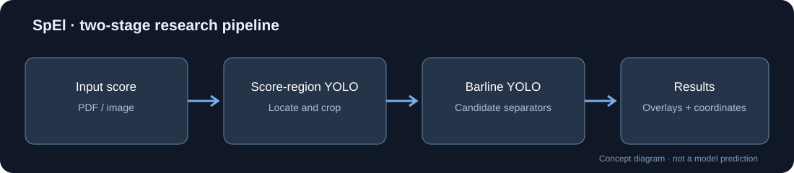

# SpEl — Experimental Music Score Analysis

**Computer vision for digital sheet music · Research prototype · Work in progress**

SpEl is a broader project devoted to the development of coordinated electronic sheet music. I am working on experimental computer-vision components intended to support its development.

**Project context:** [SpEl — Spartito Elettronico Coordinato, Orchestra Filarmonici Friulani](https://filarmonicifriulani.com/progetto/spel-spartito-elettronico-coordinato/).

The detectors documented here are **beta research prototypes**, not a finished SpEl product or a production-ready music-recognition system.

## Research objective

Build an automated pipeline to locate musical notation within scanned PDF pages and identify **barlines (measure separators)**. This is an early technical step toward score navigation and measure-level indexing.

The prototype uses two successive object detectors:

1. **Score-region detection** — locate the notation area on the original page and crop it.
2. **Barline detection** — identify candidate measure separators in the crop, then map their coordinates back to the original page.

The current local prototype supports PDF/JPG/PNG input, annotated previews, adjustable confidence thresholds, and coordinate export. It has been tested locally; **no public interactive demo is currently hosted**.

## Technology and status

- **Python**, **PyTorch**, **Ultralytics YOLO26n**, **OpenCV**, **Streamlit**.
- Two separately fine-tuned detectors, one for the score region and one for barlines.
- The local prototype has completed end-to-end functional testing.
- The barline detector is still being refined. False positives, missed separators, and variations in scan quality remain research challenges.
- **No benchmark metrics are reported here yet.** Functional tests are not a substitute for accuracy measurements on a held-out annotated dataset.

## Sample material

Example input scores used during development include:
- Beethoven — Symphony No. 5, violin part
- Brahms — Clarinet Sonata Op. 120 No. 2, including a historical scan
- Grieg — Piano Concerto Op. 16, viola part
- Mozart — Symphony No. 40, violin and oboe parts
- Mozart — Piano Concerto No. 21, bassoon part

These are **input examples**, not evidence of successful detection. Annotated model-output comparisons will be added after they are exported and reviewed. Source scans and editions have not been uploaded to this repository.

## Results and limitations

See [Results and evaluation status](RESULTS.md) for a transparent distinction between verified functionality, pending accuracy evaluation, and future output galleries.

## Availability and collaboration

This is a **results-and-documentation-only repository**. It does **not** distribute the application source code, training scripts, annotated datasets, model weights, or checkpoints.

For research collaboration or professional evaluation, please [open an issue](https://github.com/giacomocozzii/SpEl-Research/issues/new).

## Relationship to SpEl

The two detectors are experimental beta components that may contribute to future development of **[SpEl — Spartito Elettronico Coordinato](https://filarmonicifriulani.com/progetto/spel-spartito-elettronico-coordinato/)**. This repository describes independent technical research in progress; it should not be interpreted as an official product release or a claim of endorsement.

## Rights and acknowledgements

Music examples are identified by composer and work. Rights in particular editions, scans, and annotations may differ from rights in the underlying compositions. No score PDFs are redistributed here. The computer-vision models were developed using Ultralytics; distribution of model software or weights is not part of this repository.
